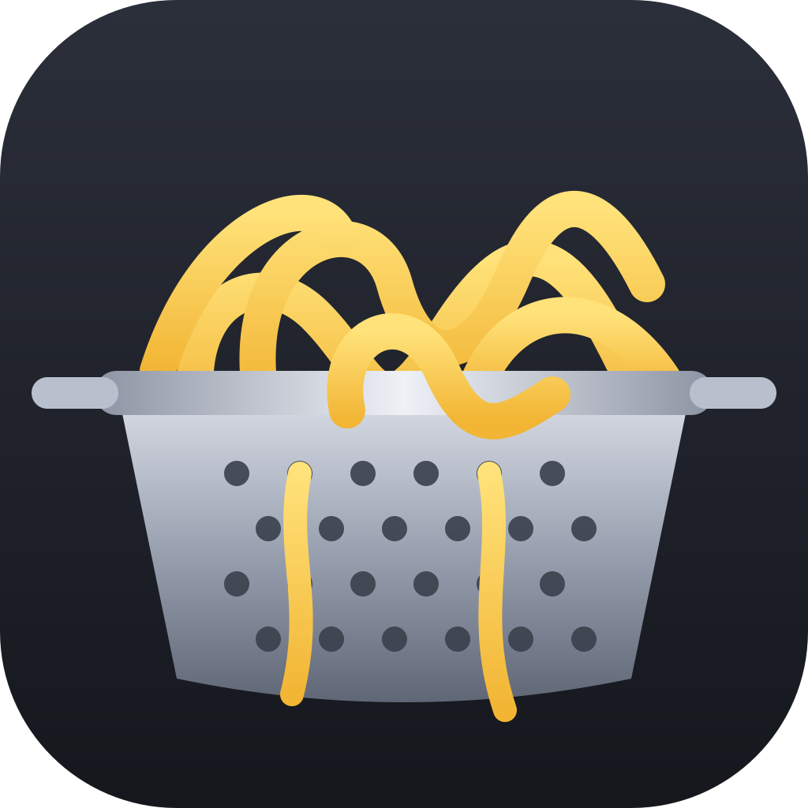

# Cobander — noodle together.

A band sketchpad. Everyone in the band records, writes, mixes and practices on their own computer, and the
song lives in one folder the band already shares (Google Drive, OneDrive, iCloud Drive or Dropbox). No server, no
accounts, no subscription. Whatever one of you noodles, the rest get in seconds.

It is not a DAW you'd mix an album in. It is the thing you open at 11 pm when a riff shows up, and the thing the
whole band opens at practice.

<p align="center"></p>

## What it does

- **Write** — tracks on a timeline, sections (Intro / Verse / Chorus…), a chord lane, lyrics pinned to where
  they're sung (Whisper speech-to-text runs on your computer), notes and replies on the timeline, needs, ideas, a
  parts bin, history and tagged versions.
- **Record** — arm a track, hit R. Takes are lossless FLAC. Punch in, comp the best bits, crash-safe recording,
  a tuner, part hotkeys, a drum machine and MIDI guitar / bass / keys for sketching without a mic.
- **Mix** — faders, pan, sends, per-track FX, Auto mix (levels by role, low-cut, EQ, compression) and Auto master
  to a loudness target, A/B against your last mix, tighten a sloppy take to the grid, pitch check on vocals, a
  timing report for every take, bounce a mix or stems, hand off to a real DAW with markers.
- **Practice** — big words and chords that follow the song, loop a part, slow it down without changing pitch,
  take instruments out, a note highway of what to play (chord grips with capo, the bass line, MIDI notes),
  Show mode for the setlist with a pedal, and a phone page so your phone follows along on the same Wi-Fi.
- **Band** — the quest board: levels and achievements for the band and each player, this song's goals, the
  setlist, who's rehearsing right now, practice minutes, loose ends (to-dos that aren't a song), chart every song
  with one button.
- **Together** — one shared folder; song locks and per-track locks so two people can work on the same song at
  once; presence ("Dan is recording"); @mentions; a band feed; in-app updates.

## Install

**Free** — the whole app, every update, one song per band folder. Windows `.exe` and Mac `mac-arm64` / `mac-x64` zips on the
[releases page](https://github.com/jeffman44/cobander/releases/latest). Open it, give yourself a name, and point it at a
folder inside the cloud folder your band shares. Everyone in the band does the same with the same folder. That's the setup.
Cobander checks for updates and installs them itself.

**Send noods 🍜** — a key that lifts the one-song limit for everyone in the band. Pay what the band can spare, once:

- **$25** — Send noods (suggested; $12 minimum)
- **$60** — Roadie: same key, plus your band's name in the credits

Download: [Windows](https://takeout.cobander.com/download/win) · [Mac, Apple silicon](https://takeout.cobander.com/download/mac-arm64) · [Mac, Intel](https://takeout.cobander.com/download/mac-x64). Get a key from the [Send noods page](https://ko-fi.com/jdeuel44) *(storefront link coming; Ko-fi works today)*. The key arrives by
email; paste it under ⚙ → **Enter a key** (or when the second song asks). It lives in the shared folder, verifies offline,
never expires, never phones home. Folders that already hold more songs keep them all.

The source is MIT and the key check is one function in `src/takeout.js`. It's a tip jar with a nudge, not DRM.

## Build it yourself

```
npm install
npm start            # run it
npm test             # unit tests
npm run e2e          # two real windows on one shared folder, under xvfb
bash scripts/build.sh all   # Windows + macOS installers into release/
```

Node 20+, Electron 44. `src/AI.md` documents the song format and the local control API (an assistant or a
script can drive a running Cobander over HTTP or a file-drop inbox).

## Extra sauce 🍲

Already have it and just want to say thanks? [Ko-fi](https://ko-fi.com/jdeuel44) or Venmo **@jdeuel44**
(links are in the app under ⚙ and on the Band page).

## Credits

Icons by [OpenMoji](https://openmoji.org) (CC BY-SA 4.0) and [game-icons.net](https://game-icons.net) (CC BY 3.0 — Lorc, Delapouite,
Caro Asercion); see `src/renderer/icons/CREDITS.md`. Band-page characters are built from the
[Liberated Pixel Cup](https://liberatedpixelcup.github.io/Universal-LPC-Spritesheet-Character-Generator/) sprites
(CC-BY-SA 3.0 / GPL 3.0, Liberated Pixel Cup contributors; per-item authors in `src/renderer/lpc/CREDITS.md`). Speech-to-text by whisper.cpp / OpenAI Whisper (MIT).

## License

MIT — see [LICENSE](LICENSE). Made by Jeff Deuel for a band in a basement.
